<picture>
  <source media="(prefers-color-scheme: dark)" srcset="assets/header-dark.svg">
  
</picture>

  
  
  

### About me

I'm a 4th-year engineering student in **Electronics & Industrial Computing** at **INSA Rennes**.
I can't leave a black box closed: I like following a signal all the way, from the op-amp that shapes it,
to the microcontroller that samples it, to the code that stores it, to the model that makes sense of it.
That curiosity is why my projects jump between analog boards, VHDL, Java backends and machine learning.

- **Now:** 4th year at INSA Rennes, France
- **Next:** Erasmus+ at **Politecnico di Torino** (Feb–Jun 2027): AI, Machine & Deep Learning, Microelectronic Systems, Operating Systems, Robotics
- **Looking for:** a 10–12 week engineering internship from **July 2027**, in embedded systems, electronics or data science
- **Speaks:** Turkish · French · English · Italian
- **Off the keyboard:** gym, football, basketball, and Galatasaray SK (member of the club's Congress)

### What I work with

<picture>
  <source media="(prefers-color-scheme: dark)" srcset="assets/stack-dark.svg">
  
</picture>

### Selected work

| Project | What it does | Stack |
|---|---|---|
| **[Sensor Data Collector](https://github.com/EfeCaginYildirim/sensor_data_collector)**  Otokar internship · MATISSE Digital Twin | Parallel REST collection of motor sensor data, batched `MERGE` into SQL Server, 50 unit tests | Java · SQL Server · JUnit |
| **[Real-Time Digital Oscilloscope](https://github.com/EfeCaginYildirim/projet_pmnd)**  INSA team project | 500 kHz STM32 acquisition over UART; I built the GTK+3 interface and the Δt / ΔV cursors | C · STM32 · GTK+3 |
| **[Falcon 9 Landing Prediction](https://github.com/EfeCaginYildirim/IBM-Capstone)**  IBM Data Science capstone | End-to-end pipeline on 90 SpaceX launches: scraping, SQL, Dash dashboard, 4 tuned classifiers | Python · scikit-learn · Dash |
| **Transistor Curve Tracer** | Board plotting IC = f(VCE) of NPN transistors on an oscilloscope in XY mode | Analog · PSpice |
| **Ultrasonic Obstacle Receiver** | 40 kHz receive chain detecting obstacles up to 1 m, 77.5 mW | Analog · PSpice |
| **CPU Execution Unit Extension** | FSM-driven iterative divider and 16-bit adder-subtractor | VHDL · RTL |

### Contributions

<picture>
  <source media="(prefers-color-scheme: dark)" srcset="https://raw.githubusercontent.com/EfeCaginYildirim/EfeCaginYildirim/output/github-snake-dark.svg">
  
</picture>

Rennes → Torino · always looking for the next layer down

